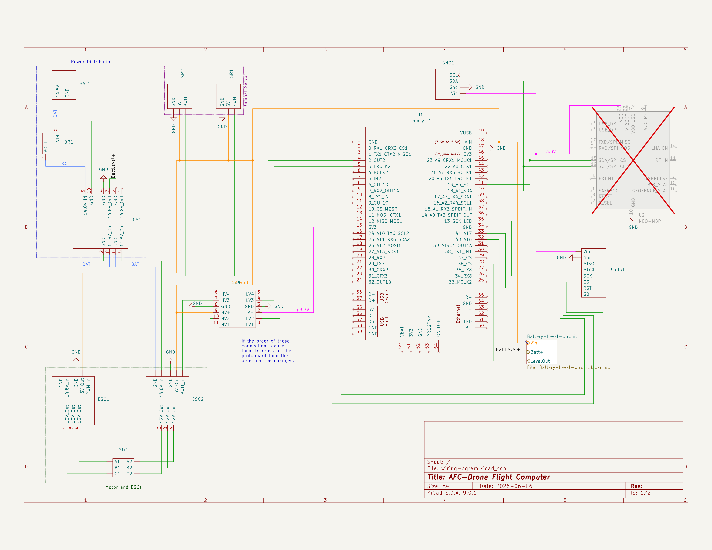

# Aeronautics and Rocketry Enterprise at Michigan Technological University

## Keweenaw Propulsion Laboratory — AFC Drone

## Project Goal

The AFC Drone is an autonomous electric test vehicle developed by the Keweenaw Propulsion Laboratory.

The goal of the project is to create a safe and reusable platform for developing technologies that may later be applied to a self-guided rocket. Because testing guidance and control systems on a liquid-fueled rocket presents significant safety and operational risks, the project begins with an electrically powered propeller vehicle.

The drone allows the team to develop and test:

* Radio communication with a ground station
* Flight-computer startup and fault handling
* Sensor initialization and orientation tracking
* Thrust and gimbal control
* Autonomous guidance algorithms
* Telemetry and command protocols
* Hardware-in-the-loop and ground testing procedures

The project is still under active development. Startup, the control-loop timing, telemetry, persistent configuration and the link-watchdog safety model are in place. Manual control of the gimbal and motors works, but autonomous flight control has not been written yet.

---

## Getting Started

New contributors should start with these documents:

| Document | Purpose |
| --- | --- |
| [Workspace Setup](docs/new_user_setup/Welcome.md) | Installing VS Code, PlatformIO, GitHub Desktop and Teensy Loader |
| [Code Conventions](docs/code-conventions.md) | Module pattern, state ownership, real-time and ISR rules, wire-format rules, and recipes for common changes |
| [Dashboard Protocol Reference](docs/dashboard-protocol.md) | Byte-level USB and RFM69 protocol, configuration keys, heartbeat and watchdog rules |
| [Battery Monitor](docs/battery/batteryinfo.md) | Voltage-divider hardware, thresholds and smoothing |
| [Battery Charging](docs/battery-charging.md) | Charger settings, charging and storage procedures for the 4S LiPo |

Pull requests follow the template in [.github/pull_request_template.md](.github/pull_request_template.md).

### Build Targets

The project builds with PlatformIO. [platformio.ini](platformio.ini) defines two environments, and both compile with `-Wall -Werror`.

| Environment | Board | Purpose |
| --- | --- | --- |
| `teensy41` | Teensy 4.1 | The flight computer. |
| `nucleo_l152re` | ST Nucleo-L152RE | Bench target that runs the same sources with only the ST-LINK USB virtual COM port connected. Radio and IMU are disabled by default so startup reaches `SAFE` without that hardware attached. This lets you test the protocol, configuration and state-machine code away from the airframe. |

```sh
pio run -e teensy41            # build the flight firmware
pio run -e teensy41 -t upload  # build and flash the Teensy
pio run -e nucleo_l152re       # build the bench target
```

The Nucleo build depends on two support files:

* [include/platform.h](include/platform.h) is force-included only in that build. It provides `elapsedMillis`, `elapsedMicros` and an STM32-backed `IntervalTimer`, and undefines ST's `USB` macro.
* [scripts/stm32_skip_rh_ask.py](scripts/stm32_skip_rh_ask.py) removes RadioHead's ASK driver from the build, because the STM32L152 has no TIM1.

---

## Code Structure

The flight software is split into modules, one per subsystem. Each module is a namespace of free functions with file-`static` state. See the [Code Conventions](docs/code-conventions.md) for the pattern.

| Module             | Responsibility                                                                                             |
| ------------------ | ---------------------------------------------------------------------------------------------------------- |
| `main.cpp`         | Arduino entry point: startup, servicing the subsystems, and the 10 Hz telemetry send                     |
| `drone.h/.cpp`     | State machine, startup sequence, 1 kHz control-timer ISR, telemetry snapshot, link watchdog, status LED    |
| `radio.h/.cpp`     | RFM69 bring-up, base-station link, packet definitions, command/config/heartbeat handling, status telemetry |
| `usb.h/.cpp`       | Framed binary USB protocol: debug text, telemetry, radio relay, commands, configuration, heartbeat         |
| `gyro.h/.cpp`      | BNO08x IMU setup, body-frame quaternion, world-frame acceleration, dead-reckoned velocity and position     |
| `gimbal.h/.cpp`    | Gimbal servo output with lookup-table (bilinear) mechanical correction                                     |
| `motor.h/.cpp`     | Top and bottom ESC output with trim offsets and safety guards                                              |
| `battery.h/.cpp`   | 4S LiPo voltage sampling, smoothing and state classification                                               |
| `configs.h/.cpp`   | Versioned persistent settings in EEPROM: load, validate, migrate, set and read                             |
| `platform.h/.cpp`  | Compatibility shims for non-Teensy targets (Nucleo bench build)                                           |
| `error.h/.cpp`     | Placeholder for the planned error buffer (currently commented out)                                         |

---

## System States

The drone uses a state machine to control startup and operation. The state values go out on the wire and are **not contiguous**.

| Value | State           | Description                                                                 |
| ----: | --------------- | --------------------------------------------------------------------------- |
|     0 | `BOOT`          | Configures the status LED and sets up the battery monitor                   |
|     1 | `RADIO_SETUP`   | Resets and configures the RFM69                                             |
|     2 | `SENSOR_SETUP`  | Initializes the BNO08x IMU                                                  |
|     3 | `CONTROL_SETUP` | Sets up the gimbal servos and ESCs and starts the 1 kHz control timer       |
|     4 | `SAFE`          | All systems are up, but nothing is allowed to move. Startup ends here       |
|    10 | `READY_ARMED`   | Gimbal movement allowed; motors held at idle                                |
|    11 | `MAN_FLIGHT`    | Gimbal and motors follow manual commands                                    |
|    12 | `AUTO_FLIGHT`   | Gimbal and motors driven by flight control. **Not implemented**; requests for it are refused |
|   255 | `FAULT_ERROR`   | Unrecoverable fault. No transition out of it; a power cycle is required     |

Every state at or above `READY_ARMED` allows some movement, and the link watchdog enforces a timeout in all of them. Every state below `SAFE` is part of startup.

After startup, state changes come from the ground station or dashboard as a requested state in the `HEARTBEAT` message (see [Link Watchdog and Heartbeat](#link-watchdog-and-heartbeat)). `Drone::requestState()` enforces these rules:

* `FAULT_ERROR` refuses every transition.
* Entering `SAFE` zeroes the motors.
* Entering `MAN_FLIGHT` zeroes the motor targets before the state changes.

---

## Startup Control Flow

`setup()` brings up the USB serial link, loads the persistent configuration from EEPROM, then calls `Drone::startup()` repeatedly until the vehicle reaches `SAFE`. Each startup stage is non-blocking, so the status LED and USB keep being serviced during startup.

1. **`BOOT`**: configures the status LED pin and sets up the battery monitor. The firmware no longer waits for a USB connection.
2. **`RADIO_SETUP`**: resets the RFM69, initializes the RadioHead driver, and sets 915 MHz, the shared encryption key and the configured transmit power (14–20 dBm, high-power mode). Startup waits only for the radio hardware. Finding the base station is a separate background step (see [Radio and Telemetry](#radio-and-telemetry)), so a missing ground station does not hold up startup. If `RadioEnabled` is `0`, this stage is skipped without touching the SPI bus.
3. **`SENSOR_SETUP`**: initializes the BNO08x over I²C and enables the game rotation vector and linear acceleration reports at 200 Hz. If `GyroEnabled` is `0`, this stage is skipped. GPS setup is planned but not yet part of the sequence.
4. **`CONTROL_SETUP`**: sets up the gimbal servos and ESCs (ESCs are held at their idle pulse width), then starts the control-loop timer.
5. **`SAFE`**: startup is complete and `loop()` begins running.

A failure in any stage moves the vehicle to `FAULT_ERROR`. In that state the firmware sends a `FAULT` debug message over USB once per second. It keeps reading incoming radio packets, but it sends no telemetry.

---

## Main Loop and Control Loop

The firmware has two execution contexts. The rules that keep them safe from each other are in the [Code Conventions](docs/code-conventions.md) (sections 7 and 8).

### Control loop (1 kHz, interrupt context)

A hardware `IntervalTimer` calls `Drone::update()` directly from its ISR every 1,000 µs. Because the ISR calls `update()` directly, the control loop keeps its timing no matter how long a pass through `loop()` takes. Each tick:

1. Reads the active setpoint (gimbal X/Y, top and bottom motor).
2. Commands the gimbal; the signed 16-bit setpoint is divided by 1638, giving about ±20°.
3. Commands the motors.
4. Records a telemetry snapshot of the whole vehicle state at that instant.

The ISR also measures its own timing: last, best, worst and rolling-average tick time, plus a count of missed ticks (ticks that overran 1,000 µs).

Code that runs in interrupt context must not use I²C, SPI, Serial, heap allocation or `delay()`, and must not push to the radio or USB transmit queues.

### Main loop (`loop()`)

Each pass services, in order:

1. Radio receive/transmit
2. USB receive/transmit
3. Reading the IMU
4. Battery sampling
5. The link watchdog
6. The status LED

Every 100 ms (about 10 Hz), `loop()` copies one telemetry snapshot from the control loop. It sends that snapshot as one USB `TELEMETRY` frame and as the radio `STATUS0`–`STATUS6` packets, so every packet in a frame describes the same instant.

### Command setpoint

`COMMAND` messages over USB or radio set the single active setpoint. The command packet still contains the `targSlot`/`activeSlot` flags from the earlier two-slot design, but the firmware currently ignores them.

---

## Link Watchdog and Heartbeat

The dashboard or ground station must send a `HEARTBEAT` message regularly, over either USB or radio, for the vehicle to keep moving. The heartbeat also carries the state the operator is requesting.

* The watchdog expires **100 ms** after the last heartbeat. A 20–50 ms heartbeat interval is recommended.
* When it expires, the gimbal and motor outputs fail safe within one control tick. The vehicle then drops to `SAFE` and latches a `TRIPPED` flag, which is reported in telemetry and shown on the status LED.
* The requested state is **edge-triggered**: the firmware acts on it only when it changes. After a trip, the dashboard must request `SAFE` and then request the flight state again, so the vehicle never re-arms on its own when the link comes back.
* A move up out of `SAFE` is refused until the vehicle has been in `SAFE` for at least 500 ms.
* Motor output is allowed only in `MAN_FLIGHT` with the watchdog fed. Gimbal output is allowed at or above `READY_ARMED` with the watchdog fed.

The full rules a dashboard implementer needs are in the [Dashboard Protocol Reference](docs/dashboard-protocol.md#link-watchdog-and-heartbeat).

---

## Radio and Telemetry

The drone uses an RFM69 radio at 915 MHz with encryption. Every radio message has an 8-byte payload, and the packet number and message type are carried in the RadioHead header.

| Type | Message | Direction |
| ---: | --- | --- |
| 0 | `SETUP` (base-station ping/ACK) | Both |
| 1–7 | `STATUS0`–`STATUS6`: system status and watchdog flags, gimbal, motors/battery/RSSI, quaternion, acceleration, velocity, position | Drone → ground |
| 8 | `COMMAND` | Ground → drone |
| 9 | `CONFIG` (one key per packet) | Both |
| 10 | `HEARTBEAT` | Ground → drone |

After the radio hardware is up, the drone sends a connection ping and repeats it every second until the base station replies with an ACK. A link that drops and comes back reconnects on its own.

On USB, the drone uses a framed binary protocol (sync bytes, sequence number, type, length, CRC-16). It carries debug text, a 64-byte telemetry record, a relay of every radio packet sent or received, commands, batched configuration, and heartbeats.

Packet layouts, scale factors and queue behavior are documented in the [Dashboard Protocol Reference](docs/dashboard-protocol.md).

---

## Persistent Configuration

Settings are stored in EEPROM with a magic value, a format version and a checksum. They are loaded at startup and can be read or changed at runtime over USB (up to nine keys per request) or radio (one key per packet). Changes are rejected while the vehicle is in `MAN_FLIGHT` or `AUTO_FLIGHT`. The current format is `CONFIG_VERSION` 3.

| Key | Default | Purpose |
| --- | --- | --- |
| `DebugMode` | 0 | Stored but not yet used by any code |
| `TxPowerDbm` | 20 | RFM69 transmit power (14–20 dBm) |
| `UsbRelayEnabled` | 1 | Relay radio traffic over USB |
| `RadioEnabled` | 1 (0 on Nucleo) | Bring up and service the radio |
| `SkipRadioHandshake` | 1 | Skip the base-station handshake |
| `GimbalPitchOffset` / `GimbalYawOffset` | 90 / 89 | Per-airframe servo trim, in degrees |
| `Motor1Offset` / `Motor2Offset` | 0 / 0 | Top/bottom motor speed trim |
| `GyroEnabled` | 1 (0 on Nucleo) | Bring up and service the IMU |

When the firmware finds an EEPROM image from an older format version, it migrates the image forward instead of resetting it, so the gimbal trim is kept. Any change to `PersistentConfig` must increment `CONFIG_VERSION` and add a matching case to `migrate()`. The [Code Conventions](docs/code-conventions.md#adding-a-configuration-setting) give step-by-step instructions, and wire IDs, value ranges and packet layouts are in the [Dashboard Protocol Reference](docs/dashboard-protocol.md).

---

## Battery Monitoring

The 4S LiPo pack voltage is read through a 5:1 resistor divider into a 12-bit ADC input and smoothed with a 16-sample exponential moving average. The firmware sorts the result into `CRITICAL_BATTERY`, `LOW_BATTERY`, `MIDPOINT`, `MAXIMUM`, or `FAULT_ERROR` for an implausible reading. The smoothed voltage is reported in telemetry.

`BATTERY_PIN` is not yet assigned. Until it is, the monitor sends a warning over USB and reports 0 V. See [Battery Monitor](docs/battery/batteryinfo.md) for the hardware and thresholds.

---

## Error Handling

Today, faults are reported through `DEBUG_TEXT` messages over USB and by moving to `FAULT_ERROR` when a startup stage fails.

A structured error system is planned: an internal buffer of errors, each with a code and a severity (low, medium, high, critical), reported over both USB and radio. The interface sketched in [include/error.h](include/error.h) is currently commented out.

---

## LED Indicators

The status LED is updated on every pass through `loop()` and during startup.

| Pattern                         |         Timing | State / condition          | Meaning                                                  |
| ------------------------------- | -------------: | -------------------------- | -------------------------------------------------------- |
| Blink                           |         100 ms | `RADIO_SETUP`              | Bringing up the radio                                    |
| Blink                           |         300 ms | `SENSOR_SETUP`             | Initializing sensors                                     |
| Breathing fade                  |   2,000 ms cycle | `SAFE`                   | All systems up, no movement allowed                      |
| Blink                           |         500 ms | `READY_ARMED` (and others) | Gimbal movement allowed                                  |
| Double flash                    | 1,200 ms cycle | `MAN_FLIGHT`/`AUTO_FLIGHT` | Flight state                                             |
| Triple flash, then pause        | 1,500 ms cycle | Watchdog tripped           | Link was lost while movement was allowed; overrides the state pattern until the operator requests `SAFE` |
| Rapid blink                     |          50 ms | `FAULT_ERROR`              | Unrecoverable fault                                      |

---

## Hardware Layout



The wiring diagram was created using KiCad 9.0 and is maintained in the [AFC Wiring Diagram repository](https://github.com/Keweenaw-Propulsion-Laboratory/AFC-Wiring-Diagram).

### Teensy 4.1 Pin Assignments

| Function | Pin | Defined in | Notes |
| --- | ---: | --- | --- |
| Gimbal pitch servo | 24 | `gimbal.cpp` | |
| Gimbal yaw servo | 25 | `gimbal.cpp` | |
| Top motor ESC | 28 | `motor.cpp` | 1000 µs idle, 1333–2000 µs running |
| Bottom motor ESC | 29 | `motor.cpp` | 1000 µs idle, 1333–2000 µs running |
| RFM69 chip select | 10 | `radio.cpp` | SPI |
| RFM69 interrupt | 40 | `radio.cpp` | |
| RFM69 reset | 41 | `radio.cpp` | |
| BNO08x IMU | I²C (`Wire`) | `gyro.cpp` | Default I²C pins |
| Status LED | 9 | `drone.cpp` | Not yet wired on the flight computer |
| Battery sense | — | `battery.cpp` | Not yet assigned (`BATTERY_PIN = -1`) |

---

## Current Development Status

The current firmware includes:

* A non-blocking startup state machine with `SAFE`, `READY_ARMED` and `MAN_FLIGHT` operating states
* A 1 kHz control loop driven by a hardware timer, with timing and missed-tick statistics
* 10 Hz telemetry over USB and radio, with every frame taken from one snapshot of the control loop
* A link watchdog with edge-triggered heartbeat state requests, a latched trip flag, and a dwell time before leaving `SAFE`
* RFM69 setup, with a background base-station link that reconnects on its own
* A framed binary USB protocol with radio relay, commands, configuration and heartbeat
* BNO08x orientation, world-frame acceleration, and dead-reckoned velocity and position
* Gimbal servo control with bilinear lookup-table correction
* Manual motor control with trim offsets and safety guards
* Battery voltage monitoring and classification
* Versioned persistent configuration in EEPROM, with migration from versions 1 and 2
* State-based LED patterns, including a separate pattern for a watchdog trip
* A Nucleo-L152RE bench build for testing without flight hardware

Work still in progress includes:

* Writing the flight-control algorithm and implementing `AUTO_FLIGHT`
* Replacing "drop to `SAFE`" with a link-loss failsafe that keeps a flying vehicle under control
* Using the heartbeat's `enableMotors` / `enableGimbal` bits
* Completing GPS support (the GPS fields currently carry fixed test values)
* Implementing the structured error buffer and reporting errors over radio
* Assigning the battery-sense pin and wiring the status LED
* Moving the remaining modules over to the [code conventions](docs/code-conventions.md#16-migration-status)
